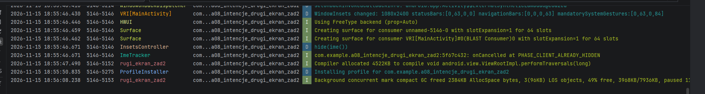
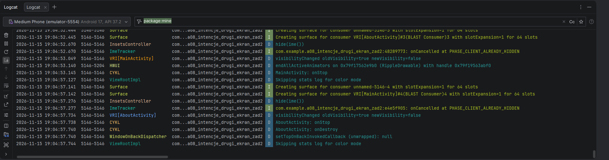

# Stos ekranów

W mojej aplikacji znajdują się trzy ekrany: MainActivity, SummaryActivity i AboutActivity.

Na początku uruchamia się MainActivity, czyli formularz rezerwacji. Kiedy kliknę DALEJ, otwiera się SummaryActivity z podsumowaniem. Pierwszy ekran cały czas pozostaje pod spodem i czeka na powrót.

Stos po otwarciu podsumowania:

```text
SummaryActivity
MainActivity
```

Kiedy kliknę Wstecz na drugim ekranie, SummaryActivity zostaje zamknięty i wracam do formularza. Stos wygląda wtedy tak:

```text
MainActivity
```

Następnie klikam przycisk O APLIKACJI. Otwiera się AboutActivity, a MainActivity pozostaje pod spodem.

```text
AboutActivity
MainActivity
```

Po kliknięciu przycisku WRÓĆ na ekranie AboutActivity wracam do formularza. AboutActivity zostaje zamknięty.

```text
MainActivity
```

Na końcu klikam Wstecz na pierwszym ekranie. Aplikacja się zamyka, ponieważ nie ma już żadnego ekranu na stosie.

Do sprawdzenia działania użyłem Log.d w metodach onCreate, onStop i onDestroy w każdej aktywności. Dzięki temu mogłem zobaczyć w Logcacie, kiedy poszczególne ekrany się uruchamiają i zamykają.

Tutaj wklejam fragment Logcatu z mojego emulatora:
 cos nie dziala stos.md na github przez to ze jest w tym folderze

Tu dla aboutactivity:
